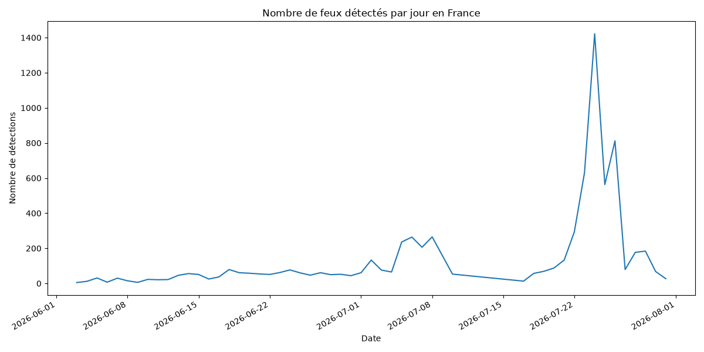
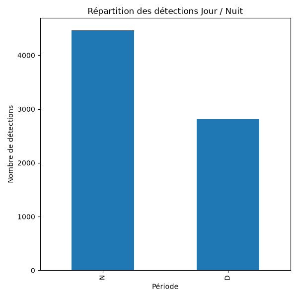
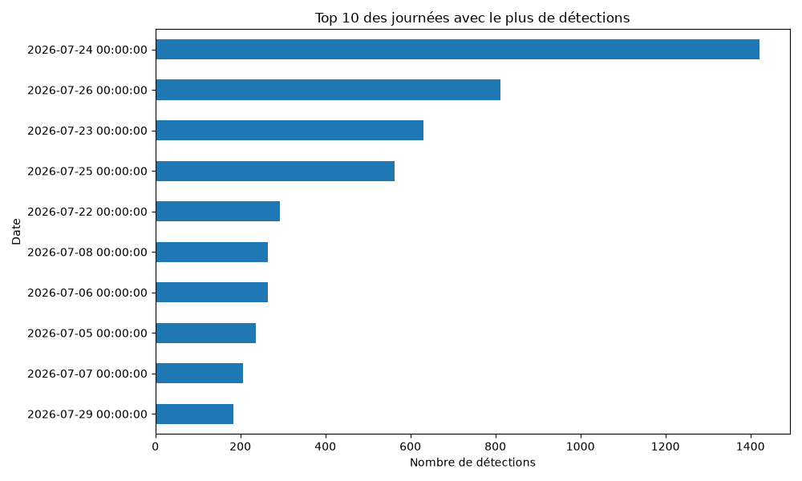
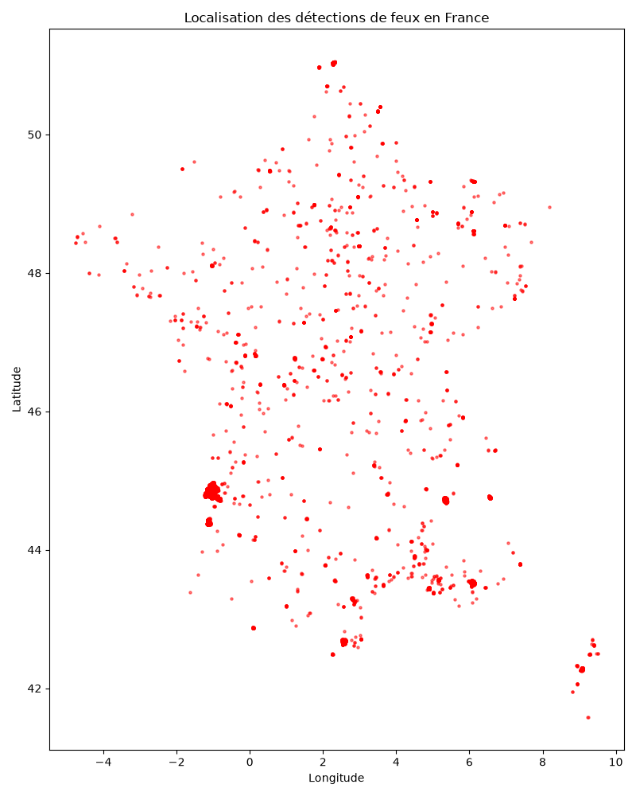

# 🔥 Forest Fire France - Analyse des feux de forêt avec les données NASA

## 📌 Présentation

Ce projet analyse les feux de forêt détectés en France à partir des données satellites de la NASA FIRMS (Fire Information for Resource Management System).

L'objectif est d'explorer les données, identifier les périodes de forte activité, analyser la répartition géographique des détections et produire des visualisations afin de mieux comprendre les événements observés.

---

## 🎯 Objectifs

- Collecter des données satellites réelles
- Nettoyer et analyser les données
- Identifier les périodes les plus critiques
- Étudier la distribution géographique des incendies
- Produire des visualisations pertinentes

---

## 🛰️ Source des données

**NASA FIRMS**

- Satellite : VIIRS S-NPP
- Période analysée : 03/06/2026 au 31/07/2026

---

## 🛠️ Technologies utilisées

- Python
- Pandas
- Matplotlib
- Git
- GitHub

---

## 📊 Résultats principaux

### Données analysées

- 7 278 détections de feux
- 15 variables analysées
- Aucune valeur manquante détectée

### Répartition Jour / Nuit

- Nuit : 4 469 détections (61,4 %)
- Jour : 2 809 détections (38,6 %)

### Pic d'activité

Le pic principal a été observé le **24 juillet 2026** avec plus de **1 400 détections**.

---

## 📈 Évolution quotidienne des détections



---

## 🌙 Répartition Jour / Nuit



---

## 🔥 Top 10 des journées les plus actives



---

## 🗺️ Localisation des détections



---

## 🔍 Principales observations

- Forte hausse des détections durant la seconde moitié du mois de juillet.
- Activité particulièrement importante entre le 23 et le 26 juillet 2026.
- Concentration des détections dans le sud de la France et en Corse.
- Majorité des détections observées durant la nuit.

---

## 📂 Structure du projet

```text
forest-fire-france/
│
├── data/
│   └── fires_france.csv
│
├── outputs/
│   ├── fires_per_day.png
│   ├── daynight_distribution.png
│   ├── top10_days.png
│   └── fire_locations.png
│
├── src/
│   ├── extract.py
│   ├── transform.py
│   ├── analyze.py
│   └── map.py
│
├── README.md
├── requirements.txt
└── .gitignore
```

---

## 🚀 Axes d'amélioration

- Analyse sur plusieurs années
- Analyse par région ou département
- Création d'un tableau de bord Flask
- Création d'une carte interactive avancée
- Automatisation complète du pipeline de données

---

## 👨‍💻 Auteur

**Alpha Diallo**

Data Analyst | Développeur Python | Futur Data Engineer

GitHub : https://github.com/Alpha38diallo

---